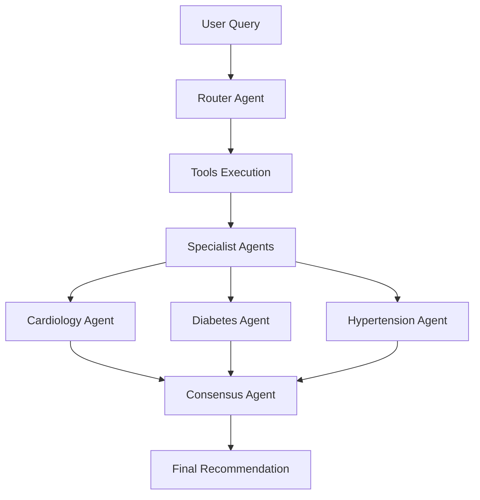

# 🏥 Multi-Agent Medical AI System
### Agentic Backbone — LangGraph Variant

A sophisticated multi-agent AI system for medical consultation and diagnosis, built with LangGraph. The system features specialized medical agents for different domains (cardiology, diabetes, hypertension) that collaborate to provide comprehensive medical insights.

## 🚀 Features

- **Multi-Agent Architecture**: Specialized agents for different medical domains
- **Router Agent**: Intelligently routes queries to relevant specialists
- **Consensus Building**: Collaborative decision-making among specialists
- **Medical Guidelines Integration**: Access to up-to-date clinical practice guidelines
- **RAG Integration**: Retrieval-augmented generation with medical literature
- **Drug Interaction Checking**: Built-in medication safety checks
- **Dosing Calculators**: Evidence-based medication dosing tools
- **Streamlit UI**: User-friendly web interface
- **Flexible LLM Support**: Compatible with Ollama and vLLM backends

## 📁 Project Structure

```
├── app.py                      # Streamlit web application
├── requirements.txt            # Python dependencies
├── agents/                     # AI agent implementations
│   ├── base.py                 # Base agent class
│   ├── router.py               # Query routing agent
│   ├── specialist.py           # Domain specialist agents
│   └── consensus.py            # Consensus building agent
├── config/                     # Configuration files
│   └── llm_config.py          # LLM provider settings
├── core/                       # Core system components
│   ├── llm.py                 # LLM interface
│   └── state.py               # Graph state management
├── data/                       # Medical data and guidelines
│   ├── guidelines/             # Clinical practice guidelines
│   │   ├── cardiology/
│   │   ├── diabetes/
│   │   └── hypertension/
│   └── rag_corpus/            # Medical literature corpus
├── graph/                     # LangGraph workflow
│   └── builder.py             # Graph construction and execution
├── tools/                     # Medical AI tools
│   ├── guidelines.py          # Guidelines search
│   ├── rag.py                 # Literature retrieval
│   ├── dosing.py              # Medication dosing
│   ├── interactions.py        # Drug interaction checking
│   └── registry.py            # Tool registry and execution
├── utils/                     # Utility functions
│   ├── formatters.py          # Response formatting
│   └── parser.py              # JSON parsing utilities
├── scripts/                   # Setup and utility scripts
│   └── setup_data.py          # Database initialization
└── helpers/                   # Development notebooks
    └── agentic-langgraph-diagnose.ipynb
```

## 🛠️ Installation

1. **Clone the repository**:
   ```bash
   git clone <repository-url>
   cd MA-CDH
   ```

2. **Install dependencies**:
   ```bash
   pip install -r requirements.txt
   ```

3. **Set up the medical database**:
   ```bash
   python scripts/setup_data.py
   ```

## Quick Start

### Option 1: Streamlit Web Interface
```bash
streamlit run app.py
```

### Option 2: Jupyter Notebook (Development)
Open `helpers/agentic-langgraph-diagnose.ipynb` for interactive development and testing.

## Configuration

### LLM Backend Configuration

Edit `config/llm_config.py` to configure your LLM provider:

**For Ollama (Recommended for local development)**:
```python
provider = "ollama"
model = "qwen2.5:1.5b-instruct"  # or "qwen2.5:7b-instruct"
endpoint = "http://localhost:11434"
```

**For vLLM (Production deployment)**:
```python
provider = "vllm"
model = "your-7b-checkpoint"
endpoint = "http://your-vllm-endpoint:8000"
```

### Model Size Selection
- **1.5B Model**: Faster inference, good for development and testing
- **7B Model**: Better accuracy, recommended for production use

## Usage

### Web Interface

1. Launch the Streamlit app: `streamlit run app.py`
2. Configure your LLM provider in the sidebar
3. Enter medical queries in natural language
4. Review responses from specialist agents
5. View the final consensus recommendation

## 🏗️ Architecture

### Agent Workflow



### Key Components

- **Router Agent**: Analyzes queries and determines which specialists to involve
- **Specialist Agents**: Domain-specific agents with access to relevant tools and guidelines
- **Consensus Agent**: Synthesizes specialist recommendations into coherent advice
- **Tools System**: Provides access to medical databases, guidelines, and calculators

## Available Tools

| Tool | Description | Usage |
|------|-------------|-------|
| `search_guidelines` | Clinical practice guidelines search | Treatment protocols, diagnostic criteria |
| `retrieve_rag` | Medical literature retrieval | Research evidence, studies |
| `calc_dose` | Medication dosing calculator | Weight/eGFR-based dosing |
| `check_interactions` | Drug interaction checker | Safety screening |

## Medical Domains

The system currently supports:

- **Cardiology**: Heart disease, hypertension, cardiovascular risk
- **Diabetes**: Type 1/2 diabetes, glucose management, complications
- **Hypertension**: Blood pressure management, antihypertensive therapy

## Development

### Adding New Specialists

1. Create a new agent class inheriting from `BaseAgent`
2. Define domain-specific system prompts
3. Register specialist tools in `tools/registry.py`
4. Update the graph builder in `graph/builder.py`

### Adding Medical Guidelines

1. Add JSON files to appropriate `data/guidelines/` subdirectory
2. Follow the existing schema structure
3. Run `python scripts/setup_data.py` to update the database


